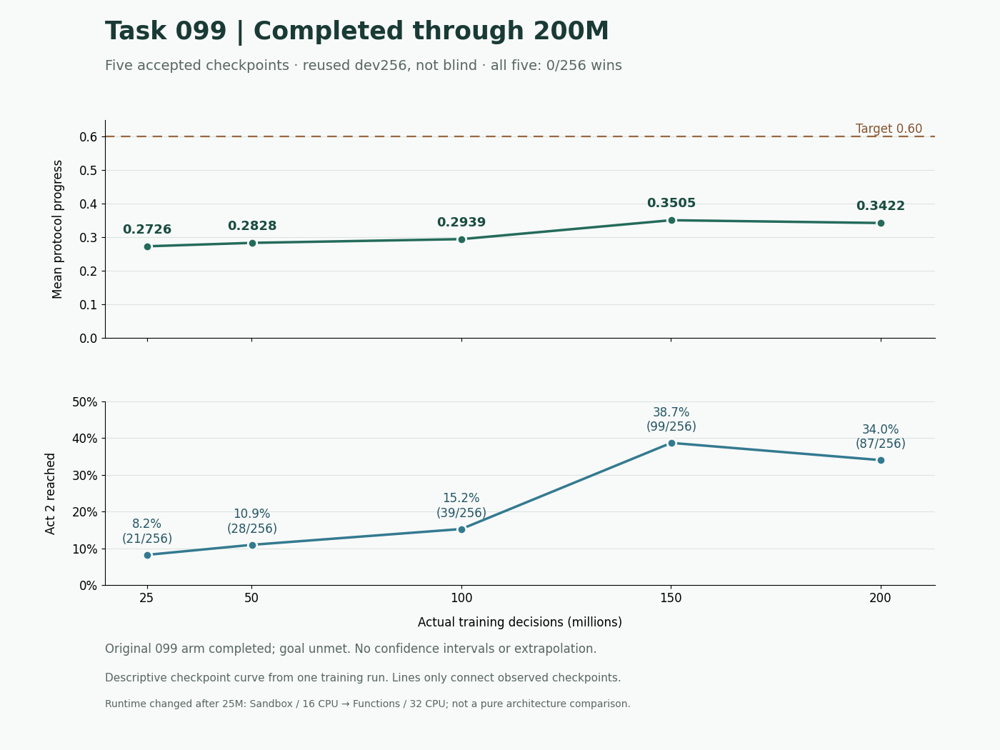

# STS2 GPT / Modal training research

Co-author snapshot: `codex/sts2-gpt-research-share-20261106`.
Evidence cutoff: **2026-11-06 05:09:53 UTC / 00:09:53 America/Detroit**.

中文摘要：本分支共享 GPT 研究线的实际训练代码、架构、配方与进度。
Task099 已完成约 200M 决策，dev256 平均进度 **0.3422、0/256 通关**；
最高观测点为 150M 的 0.3505。Task104 已接受约 24.64M 训练步，尚无新质量评测。
目标未达，blind1000 未用于选型。研究建议在 issues 中，未混入已验证结果。

## Co-author entry points

- [Research guide, source identities and reproduction boundaries](research/gpt-training/README.md)
- [Actor / Value architecture, reward and batching](research/gpt-training/ARCHITECTURE.md)
- [Progress and limitations](research/gpt-training/PROGRESS.md), [JSON](research/gpt-training/progress.json), [CSV](research/gpt-training/learning-curve.csv)
- [Research roadmap #37](https://github.com/Alchemist-X/hack-sts2/issues/37)
- [Source manifest](research/gpt-training/source-manifest.json) and [publication validation](research/gpt-training/VALIDATION.md)

This GPT-managed research line trains a small entity-encoder / Transformer policy
with PPO in the **headless C# rules simulator**. It is a game policy, not GPT weights
being fine-tuned. Silent A10, autonomous fresh starts, public observations and legal
candidates; no human trajectories, external/Claude weights, save starts or harvest.

The actor and critic share a 3-layer Transformer (`d=192`, 6 heads), with a 384-wide
state vector. The actor scores legal candidates; the critic uses the state plus a
detached mean of candidate embeddings. Policy including critic: **2,941,072 parameters**;
transition auxiliary head: **37,188**; total: **2,978,260**.

Training uses 2,048 environment slots × 64 decisions = 131,072 transitions per
rollout; minibatch 4,096, one epoch, 32 main optimizer updates per full valid batch.
Later runs use one H100, 32 physical CPU cores, 64 GiB, strict FP32.

## Accepted Task099 development curve

| Decisions | Mean progress | Act 2 / 256 | Act 3 / 256 | Wins / 256 |
|---:|---:|---:|---:|---:|
| 25,034,752 | 0.2725516563 | 21 | 0 | 0 |
| 50,069,504 | 0.2828294961 | 28 | 0 | 0 |
| 100,007,936 | 0.2939402695 | 39 | 0 | 0 |
| 150,077,440 | 0.3505400039 | 99 | 0 | 0 |
| 200,015,872 | 0.3421844336 | 87 | 0 | 0 |



One initialization, reused dev256, no blind result. The 200M versus 150M point
decrease is not proof of certain regression. Runtime changed after 25M, so this
curve does not isolate architecture effects. Goal: mean progress at least 0.6 and
win rate above 0.1; **not achieved**.

## Actual code and proposed work

- [Task099 exact worker source](research/gpt-training/releases/task099/code/): accepted 200M lineage.
- [Task104 exact worker source](research/gpt-training/releases/task104/code/): public HandSelect input mapping.
- [Modal Function transport](research/gpt-training/modal-function/): 32-core overlay; live release descriptors excluded.
- [Train-package mirror](sim/tools/train/sts2train/): Task104 files; inherited CLI helpers are not the production entry point.

Issues: [#31 Value capacity](https://github.com/Alchemist-X/hack-sts2/issues/31),
[#32 milestone rewards](https://github.com/Alchemist-X/hack-sts2/issues/32),
[#33 rollout/GAE](https://github.com/Alchemist-X/hack-sts2/issues/33),
[#34 separate critic](https://github.com/Alchemist-X/hack-sts2/issues/34),
[#35 PPO audit](https://github.com/Alchemist-X/hack-sts2/issues/35),
[#36 Q-learning](https://github.com/Alchemist-X/hack-sts2/issues/36).
These are proposals, not deployed improvements.

```bash
git clone --branch codex/sts2-gpt-research-share-20261106 https://github.com/Alchemist-X/hack-sts2.git
cd hack-sts2
python3 research/gpt-training/verify_snapshot.py
```

The standard-library verification command checks hashes, syntax and aggregate
consistency without loading weights, starting a game or contacting Modal. This
publication changes no live service, ledger, budget or main research worktree.
Newly published material excludes credentials, model checkpoints, raw trajectories,
saves, runtime logs, private reasoning and operational databases. Native runtime
assets and live resource descriptors must be provisioned separately.

---

## Inherited repository overview (historical, other workflows)

The following overview describes the broader recorder/official-engine workflow.
It is **not** the environment description or results of the GPT simulator-training
line above. Older model cards and other agents' results must not be combined with
this lineage's curve.

Full-trajectory recorder and official-engine-backed text environment for
**Slay the Spire 2** — the STS2 counterpart of
[hack-balatro](https://github.com/Alchemist-X/hack-balatro)'s real-client pipeline.

The project has two complementary modes:

1. **Passive recording** — while a human plays normally, a first-party mod-loader
   mod records every observable state and committed action to local, versioned,
   append-only artifacts.
2. **Evaluation and training** — isolated, text-only workers run the official game
   engine with rendering and Steam disabled, exposing structured observations,
   enumerated action candidates, action masks, rewards, episode boundaries, and
   action-space audit metadata to RL policies, search procedures, or LLM
   controllers.

The text environment does not approximate or reimplement STS2 rules: the official
game process remains the state-transition engine.

> Research project. Data-cooperation agreement with the developer is in place;
> the game copy is legally owned. Human recording is local-only — nothing is
> uploaded. Sandbox workers use isolated save directories and never touch human
> saves.

## How it works

- **`mod/`** — a C# mod (`Sts2Recorder.dll`) loaded by STS2's *official* first-party
  mod loader. Harmony postfix patches on the game's human-input funnels capture the
  exact action stream; the game's native `CombatHistory` provides fine-grained combat
  events (true draw order, damage, energy); a throttled snapshotter writes full
  hash-deduped state JSON at every decision point. At run end it archives the game's
  own `.run` summary and `latest.mcr` deterministic replay alongside our streams.
  This recorder is observation-only and declares `affects_gameplay: false`.
- **`sts2rec/`** — Python recording, evaluation, and training APIs: list/validate
  sessions, canonicalize human trajectories, enumerate candidate actions, filter
  privileged information, drive one or many text workers, and stream compact
  transition JSONL with coverage audits.
- **`scripts/headless_provision.sh` / `scripts/headless_launch.sh`** — create one
  shared official-engine runtime plus lightweight per-worker homes, ports, logs,
  saves, and trajectory directories. Workers normally run with Godot `--headless`
  and `--force-steam=off`; `--visible` shows one isolated worker without changing
  its HOME, save tree, port, or recording directory. By default worker profiles
  copy the human settings and seed unlocks from the human profile (the E3
  coverage farm relies on this); `STS2_HEADLESS_FRESH_PROFILE=1` provisions
  fresh profiles that never read the human save tree (benchmark pools, whose
  save tree is replaced by a frozen baseline anyway). The worker MCP is built from `config/sts2mcp.lock.json` (upstream commit, ordered
  patches, pinned game build) by `scripts/build_selection_mcp.sh`.

State serialization is adapted from [STS2MCP](https://github.com/Gennadiyev/STS2MCP)
(MIT). The human recorder keeps its action-injection and HTTP surface removed; the
isolated training runtime uses a separate controller build and is never installed
into the human-play environment.

Full architecture and format spec: [docs/design.md](docs/design.md). Text-environment
commands, API examples, and current limitations: [docs/text-environment.md](docs/text-environment.md).
Dataset, training, and benchmark protocol:
[docs/training-and-evaluation.md](docs/training-and-evaluation.md).

## Session layout

```
<output_root>/sessions/<start_unix>-<seed>/
  manifest.json    # schema/game/mod versions, seed, character, result
  states.jsonl     # full state snapshots at stable decision points
  actions.jsonl    # exact human actions (Harmony-hooked, not diff-inferred)
  events.jsonl     # combat history: draws, damage, energy, … (privileged channel)
  native/          # the game's own .run summary + .mcr replay for cross-validation
```

Default `<output_root>`: `~/Library/Application Support/Sts2Recorder` (macOS).

## Passive recorder (macOS)

```bash
brew install dotnet@9
./scripts/install_mod.sh   # builds mod against your game install, copies into mods/
```

Then launch STS2 with "Load with Mods" and accept the mod-consent dialog once.
Play normally; sessions appear under the output root.

```bash
cd sts2rec && uv run sts2rec sessions      # list recorded runs
uv run sts2rec validate <session-dir>      # schema + consistency checks
uv run sts2rec canonical <session-dir>     # emit canonical trajectory JSON
```

## Evaluation and training environment

From `hack-sts2/sts2rec`:

```bash
# Build/update one shared runtime and start four isolated text workers.
uv run sts2text pool start 4 --base ../headless-instances

# Inspect a structured state and the currently enumerated action candidates.
uv run sts2text observe --port 15601
uv run sts2text observe --port 15601 --json

# Play through the same interface manually from a terminal.
uv run sts2text play --port 15601 --character NECROBINDER

# Inspect resource usage, then stop workers without touching human saves.
uv run sts2text pool status --base ../headless-instances
uv run sts2text pool stop --base ../headless-instances
```

To supervise a single isolated game window, provision normally and launch it
directly with recording enabled:

```bash
./scripts/headless_provision.sh 1
./scripts/headless_launch.sh 1 --visible --record
./scripts/headless_launch.sh 1 --stop
```

Only one visible worker is allowed. `scripts/hash_human_saves.sh` can be run
before and after a smoke test to verify that the real Steam save tree did not
change.

For supervised agent play, `scripts/sts2_action_executor.py` is deliberately a
single-action transport, not a combat policy. The external reasoner must inspect
the full public state, choose every card/target/end-turn decision, and provide a
reason plus the observed state hash. The executor rejects stale decisions,
waits for semantic card commitment and a quiet settlement window, and writes a
durable intent before injection followed by a linked outcome:

```bash
python3 scripts/sts2_action_executor.py --port 15601 observe --full
python3 scripts/sts2_action_executor.py --port 15601 act \
  --expected-hash STATE_SHA256 \
  --json '{"action":"play_card","card_index":3,"target":"ENEMY_0"}' \
  --reason 'Externally chosen after comparing the full turn state.' \
  --controller llm --log output/decisions.jsonl
```

There is intentionally no generic heuristic combat driver. Training and
benchmark policies remain separate interfaces and must identify their own
controller provenance.

For per-game live narration, version-checked rule retrieval, pending-action
recovery, and reward/potion/token audits, use `scripts/sts2_live.py`. Read the
[live-play protocol](docs/sts2-live-protocol.md) for setup and commands, and the
[live harness architecture](docs/live-harness-architecture.md) for its decision
and improvement workflow. The live controller does not load the offline learned
policy or value models. The [A10 case-study release](https://github.com/Alchemist-X/hack-sts2/releases/tag/sts2-a10-gpt6-2026-09-09)
contains separately archived gameplay evidence and saves; these are not Git
source files or a qualified independent benchmark.

The Python interface supports arbitrary policy callables and concurrent episodes:

```python
from sts2rec.env import Sts2Env
from sts2rec.information import InformationMode
from sts2rec.text_env import Sts2TextEnv, TextEnvConfig, VectorSts2TextEnv

workers = [
    Sts2TextEnv(
        Sts2Env(15601 + i),
        config=TextEnvConfig(information_mode=InformationMode.LIMITED),
        worker_id=i + 1,
    )
    for i in range(4)
]

with VectorSts2TextEnv(workers) as env:
    observations = env.reset(character="NECROBINDER")
    next_observations = env.step([policy(obs) for obs in observations])
```

Every time step contains a leakage-filtered observation, indexed `legal_actions`
(the API name for the current candidate set), an `action_mask`, reward,
`terminated` / `truncated`, and action-space audit data. The audit can flag known
incompleteness; the current implementation does not certify that its candidates
equal the engine's complete action space in every game screen.
Two information contracts are available:

- **`limited`** exposes only information available to a human at that decision.
- **`omniscient`** adds a physically separate privileged channel for oracle
  evaluation and must not be mixed into limited-policy training data.

Typical consumers include behavior cloning, offline/online RL, learned value
functions, tree search, and LLM-controlled agents. Controlled online evaluation
is possible after the reset, seed, and action-space qualification gates described
in the training protocol are satisfied.
Training trajectories contain structured `(s, A(s), a, r, s', done)` transitions;
screenshots and frame extraction are not part of the loop.

The portable dataset and baseline commands are pure Python and do not start the
game:

```bash
cd sts2rec
uv run sts2train dataset build transitions.jsonl -o ../datasets/limited.jsonl
# Or strictly align confirmed actions from passive recorder sessions.
uv run sts2train dataset build-human <session-dir> -o ../datasets/human.jsonl
uv run sts2train dataset audit ../datasets/limited.jsonl
uv run sts2train train bc ../datasets/limited.jsonl -o ../checkpoints/bc.json
uv run sts2train evaluate bc ../datasets/limited.jsonl --model ../checkpoints/bc.json
```

See the [training and evaluation protocol](docs/training-and-evaluation.md) for
run-level splitting, value training, NoSL/SL aggregation, and promotion gates.
The benchmark vocabulary follows the game: A10 is the maximum ascension and
A0-A10 denotes the complete difficulty range. The strict ladder definition is in
the [NoSL A0-to-A10 protocol](docs/no-sl-ascension-10.md).
The human adapter rejects ambiguous, automatic, cancelled, estimated-state, and
incomplete-action-space decisions instead of guessing labels. Incomplete runs can
contribute behavior-cloning examples but never terminal value targets.
Formal benchmark aggregation is spec-bound: the spec fingerprints the game,
controller, policy, ordered seed cases, timeout/step limits, mod/unlock state, and
SL budget. NoSL qualification additionally requires explicit zero-reload and
complete trajectory-hash evidence, while strict SL requires one complete hashed
trajectory per attempt. The formal CLI re-hashes every referenced trajectory
artifact and enforces the frozen timeout and step limit; exploratory reports
without a spec are never presented as qualified results.

### Current boundaries

- The current text controller's native `game_over` snapshot does not expose an
  authoritative win/loss field. Such terminal outcomes are recorded as `null`,
  never guessed as defeats, and are rejected by the value-data quality gate;
  otherwise valid demonstrated actions remain usable for behavior cloning.
  Passive human sessions can still use their recorder manifest outcome. Online
  headless value/RL qualification requires adding a verified engine outcome to
  the controller contract.
- The worker pool is currently verified on macOS arm64. Linux packaging remains a
  separate deployment task because the official Linux game build is x86_64.
- Exact arbitrary **mid-combat clone/restore is not yet supported**. Independent
  reset-driven episodes are supported, but benchmark-controlled seed injection and
  verification are not yet implemented. Precise counterfactual branching requires
  an in-engine checkpoint serializer or deterministic action-prefix replay.
- The environment requires a legally owned game installation and pins every
  trajectory to its exact game version/build. Game assets are not included here.
- STS2 is in Early Access. Legal-action coverage, hooks, and model compatibility
  must be regression-tested whenever the game version changes.

## Version compatibility

STS2 is Early Access and moves fast. Every hook installs independently and degrades
gracefully: after a game update, a missing method disables that one hook (recorded in
`manifest.degraded_hooks`) while polling snapshots keep the session usable. Every
manifest stamps the exact game version/commit/build. See
[docs/design.md](docs/design.md#version-drift-policy-early-access-reality).

## License

MIT — see [LICENSE](LICENSE). Contains code adapted from STS2MCP (MIT, © 2026
Yikun Ji).
