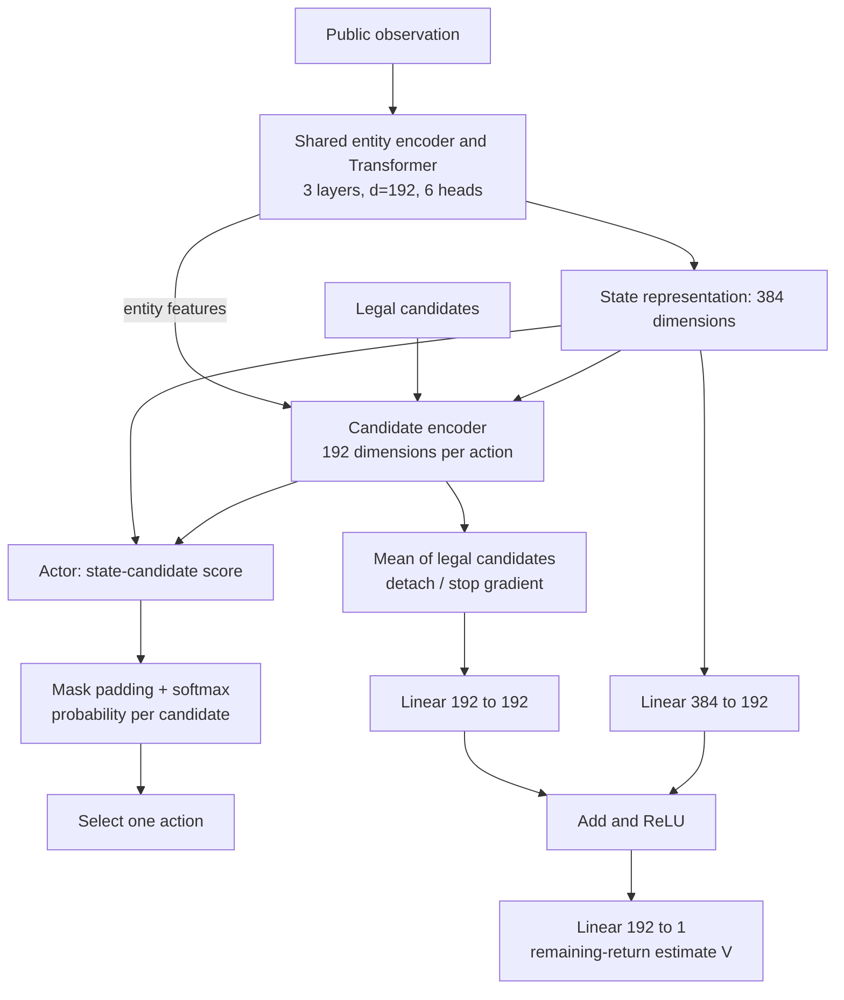

# Actor, critic and training objective

Task099/Task104 architecture, with auxiliary prediction heads omitted for clarity.
Task104 additionally routes publicly unambiguous HandSelect options to current-hand
features; it adds no parameters.

V is one scalar per observation, not a Q-value per action or a calibrated win
probability. There is no sigmoid on V. Both actor and value losses train the shared
state encoder. Value gradients stop at the detached candidate-mean path but reach
the trunk through the state path. Auxiliary win/combat heads and a separate
transition prediction head contribute additional losses.

## Reward

`reward = delta(protocol_progress) + 1*win - 0.01*verified_cycle`.
There is no active fixed reward for picking cards, relics or upgrades. Protocol
progress is 1 on a win, otherwise `((act-1)+min(c,L-1)/L)/3`, with protocol cleared
room count `c` and current-act room count `L`.

At gamma=1, a complete fresh episode's return is final progress plus win bonus minus
cycle penalties. At progress 0.20, losing at 0.35 without cycles gives remaining
return 0.15; eventually winning gives 1.80. V estimates expected remaining return
under the current policy, not current progress or health.

GAE uses `delta_t = r_t + gamma*V_next - V_t`, gamma=1, lambda=0.99;
the value target is `old_V + advantage`. Valid time-limit bootstraps are handled
separately from true terminal transitions. A rollout boundary does not end a game.
Complete realized returns and bootstrapped targets must be distinguished in diagnostics.

## Decisions and batching

A card plus its target is one decision; EndTurn is one; a potion plus target is one.
Subsequent discard/selection/confirmation prompts can each require another decision.
Enemy resolution and animation are automatic. Reward macros can combine opening
card choice and selecting a card. Candidate count is not decision count.

| Quantity | Recipe |
|---|---:|
| Inference states | 2,048 |
| Rollout decisions per slot | 64 |
| Full rollout transitions | 131,072 |
| Optimizer minibatch | 4,096 |
| PPO epochs | 1 |
| Main optimizer updates per full valid rollout | 32 |
| Episode decision limit | 1,200 |
| Non-combat decisions on one floor limit | 80 |

The 32-core CPU schedules 2,048 simulator states, not 2,048 machines. The transition
auxiliary optimizer has a separate counter. A larger value head does not itself
extend rollouts, add recurrent memory or create unseen late-game outcomes.
