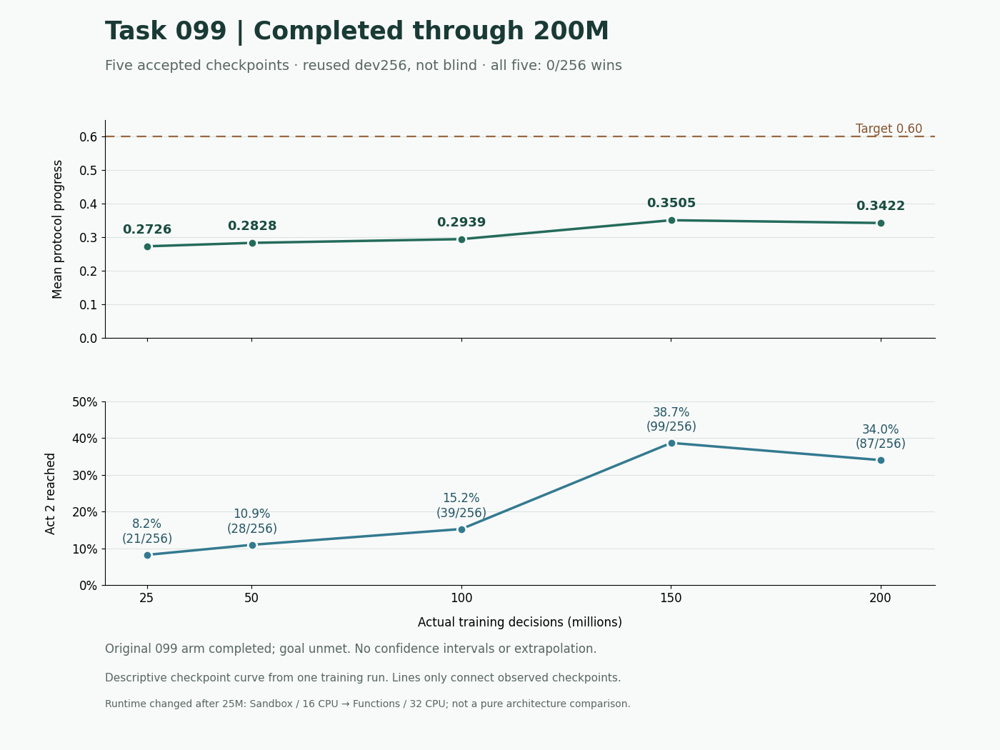

# Progress snapshot and interpretation

Evidence cutoff: **2026-11-06T05:09:53Z / 2026-11-06 00:09:53 EST**.
This is a curated result summary, not a live operations report.

## Task099: original 200M plan completed

Task099 trained from random initialization through autonomous fresh games. It
reached 200,015,872 valid decisions (1,526 rollout updates), and the scheduled
dev256 evaluation was accepted. The research target remains unmet.

| Decisions | Mean progress | Act 2 / 256 | Act 3 / 256 | Wins / 256 |
|---:|---:|---:|---:|---:|
| 25,034,752 | 0.27255165625 | 21 | 0 | 0 |
| 50,069,504 | 0.28282949609375 | 28 | 0 | 0 |
| 100,007,936 | 0.29394026953125 | 39 | 0 | 0 |
| 150,077,440 | 0.35054000390625 | 99 | 0 | 0 |
| 200,015,872 | 0.34218443359375 | 87 | 0 | 0 |

The curve shows learning of earlier-act progress with non-monotonic growth, but
no wins. The 200M minus 150M point difference is about -0.00836; no new paired
uncertainty analysis was performed for this publication. Do not infer definite
regression or inevitable future improvement.

These are repeated dev measurements from one initialization, not independent
replications or blind tests. Runtime changed from Sandbox/16 CPU to Function/32 CPU
after 25M, so this is not a pure architecture comparison. Greedy evaluation uses
no search or loop breaker. Blind1000 was not used for selection.

Final dev256 contained 256 losses and no reported stuck/capped/illegal/crash cases.
This does not erase the training limitations below.

## Observed limitations

- 869,319 closed training episodes, zero wins.
- Act2 learning: 9,851,148 steps, 4.9252% of all learning steps.
- Act3 learning: 17,417 steps, about 0.0087%. Training exposure is not validated
  greedy Act3 ability; dev256 had zero Act3 reaches.
- Native table overflow: 32 flagged slot-status observations, impact unknown.
  This does not imply exactly 32 independent episodes or actor samples.
- Twelve resumptions discarded 24,576 in-flight fresh episodes. These are censored
  episodes, not completed losses or game-save restores.
- Small mean GAE residuals do not prove accurate realized-return predictions.
  Actual terminal distance and actor/critic gradient conflict were not established.

## Task104: training accepted, quality pending

Task104 adds publicly unambiguous HandSelect-to-hand input mapping with unchanged
parameter count and numeric PPO recipe. It starts a fresh lineage; its steps must
not be added to Task099's counter as if continuing the same model.

First accepted segment: **24,641,536 decisions / 188 updates**. Recorded runtime:
H100 80GB, native/Torch/inter-op 32 threads, fresh CUDA gate passed. At the cited
observation it was three updates short of 25M with **no quality evaluation**.
Continuation was blocked by a per-arm budget-map binding defect; main-thread repair
was in progress. This publication neither performs nor claims that repair.

Task107 continuation and other offline proposals were not completed experiments at
this cutoff. New issues #31–#36 are also proposals, not results.

## Costs and provenance

Per-run settled costs are unavailable. Workspace meters, reservations and summed
iteration seconds differ; no dollar curve is fabricated. This share starts no new
training/evaluation job. Older S/M capacity runs and S25M plateau results belong to
different recipes; do not splice them into Task099's curve or attribute other
agents' historical model cards to this lineage.

[JSON](progress.json), [CSV](learning-curve.csv) and [manifest](source-manifest.json)
preserve aggregate values and source-analysis hashes. Original per-seed records,
trajectories, checkpoint bodies and operational ledgers remain outside Git. Raw
statistical reproduction requires separately provisioned original evidence.
